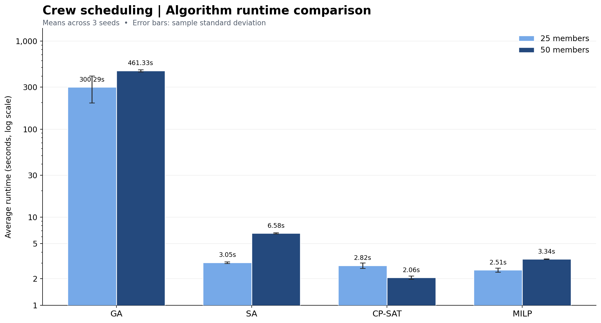
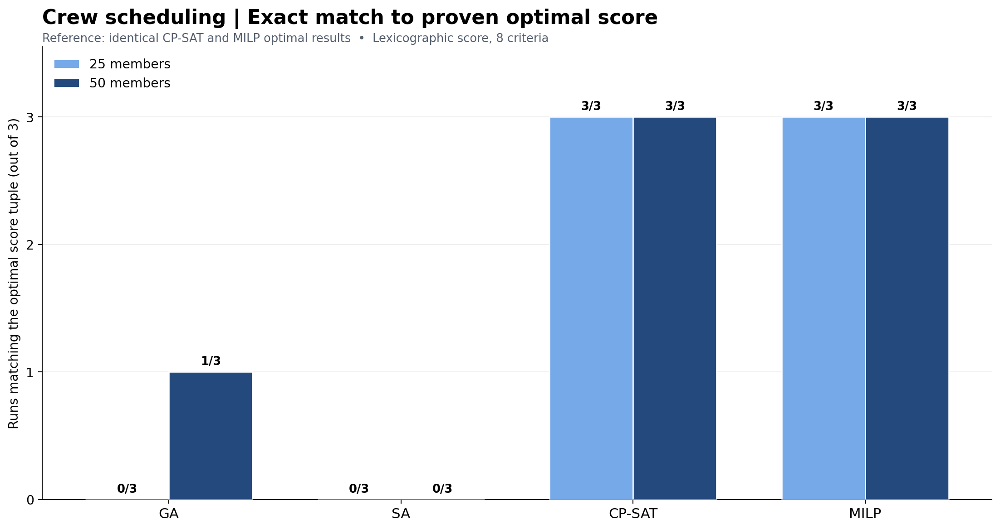

# Crew Scheduling Optimization

### Σύγκριση τεσσάρων αλγορίθμων για τη δημιουργία προγράμματος βαρδιών

Σε αυτό το project ασχολήθηκα με την αυτόματη δημιουργία ενός μηνιαίου προγράμματος βαρδιών. Το πρόβλημα φαίνεται σχετικά απλό στην αρχή, αλλά γίνεται πιο δύσκολο όταν πρέπει να τηρούνται ταυτόχρονα αρκετοί κανόνες: σταθερός αριθμός ατόμων ανά ημέρα, κατάλληλες ειδικότητες, ελάχιστη απόσταση ανάμεσα στις βάρδιες και συγκεκριμένες προτεραιότητες στην κατανομή τους.

Για να εξετάσω διαφορετικούς τρόπους επίλυσης, υλοποίησα και συνέκρινα τέσσερις αλγορίθμους:

- **Genetic Algorithm (GA)**
- **Simulated Annealing (SA)**
- **Constraint Programming – CP-SAT** (Google OR-Tools)
- **Mixed-Integer Linear Programming – MILP** (PuLP / CBC)

Η βασική ιδέα ήταν να λύσουν όλοι **το ίδιο πρόβλημα**, να ελεγχθούν με τους **ίδιους κανόνες** και να αξιολογηθούν με την **ίδια συνάρτηση βαθμολογίας**. Έτσι, η σύγκριση δεν περιορίζεται στο αν βρέθηκε ένα πρόγραμμα, αλλά εξετάζει και την ποιότητα της λύσης και τον χρόνο που χρειάστηκε.

> **Σημείωση:** Τα πειράματα χρησιμοποιούν συνθετικά δεδομένα προσωπικού (`dummy`). Δεν περιλαμβάνονται πραγματικά στοιχεία εργαζομένων.

## 1. Το πρόβλημα

Στη βασική μορφή του προβλήματος έχουμε:

| Παράμετρος | Τιμή |
|---|---:|
| Ημέρες προγραμματισμού | 31 |
| Άτομα ανά ημερήσια βάρδια | 5 |
| Ελάχιστη απόσταση μεταξύ βαρδιών του ίδιου ατόμου | 3 ημέρες |
| Μεγέθη συνθετικού πληθυσμού που δοκιμάστηκαν | 25 και 50 άτομα |
| Απαιτούμενες αναθέσεις ανά μήνα | 155 |

Κάθε ημέρα χρειάζεται έναν κατάλληλο υπόλογο, έναν μηχανικό και έναν ηλεκτρολόγο. Ο μηχανικός και ο ηλεκτρολόγος πρέπει να είναι διαφορετικά άτομα. Ο υπόλογος μπορεί να έχει ταυτόχρονα έναν από αυτούς τους ρόλους, εφόσον έχει το απαιτούμενο προσόν.

### Υποχρεωτικοί κανόνες (hard constraints)

- Ακριβώς πέντε **διαφορετικά** άτομα ανά ημέρα.
- Οι ειδικοί ρόλοι ανατίθενται μόνο σε κατάλληλα άτομα που συμμετέχουν στη συγκεκριμένη βάρδια.
- Ο μηχανικός και ο ηλεκτρολόγος δεν επιτρέπεται να είναι το ίδιο άτομο.
- Το ίδιο άτομο δεν μπορεί να έχει δύο βάρδιες με απόσταση μικρότερη από τρεις ημέρες.

### Κριτήρια ποιότητας (soft objectives)

Εφόσον τηρούνται οι υποχρεωτικοί κανόνες, προσπαθούμε να περιορίσουμε τις υπερβάσεις των προβλεπόμενων βαρδιών, να τις κατανείμουμε καλύτερα και να δώσουμε αργίες και Παρασκευές σε περισσότερα διαφορετικά άτομα, λαμβάνοντας υπόψη τις προτεραιότητες αρχαιότητας.

Τα όρια βαρδιών ανά βαθμό **δεν είναι απόλυτα απαγορευτικά**: αν οι διαθέσιμες θέσεις δεν επαρκούν, επιτρέπονται υπερβάσεις, οι οποίες όμως επιβαρύνουν τη βαθμολογία.

## 2. Πώς συγκρίνονται τα προγράμματα

Η `core/scoring.py` επιστρέφει μια πλειάδα οκτώ τιμών:

```python
(hard, total_over, dist, miss_h_count,
 miss_h_priority, load_h, miss_f_count, miss_f_priority)
```

Οι τιμές συγκρίνονται **λεξικογραφικά**: πρώτα το πρώτο κριτήριο, έπειτα το δεύτερο μόνο σε ισοβαθμία, μετά το τρίτο κ.ο.κ. Σε όλα τα κριτήρια, μικρότερη τιμή σημαίνει καλύτερη βαθμολογία.

| Σειρά | Κριτήριο | Τι μετρά |
|---:|---|---|
| 1 | `hard` | Παραβιάσεις υποχρεωτικών κανόνων |
| 2 | `total_over` | Συνολικές υπερβάσεις ορίων βαρδιών |
| 3 | `dist` | Ποινή κατανομής υπερβάσεων |
| 4 | `miss_h_count` | Πόσα άτομα δεν πήραν αργία |
| 5 | `miss_h_priority` | Σταθμισμένη προτεραιότητα αργιών |
| 6 | `load_h` | Σταθμισμένο φορτίο αργιών |
| 7 | `miss_f_count` | Πόσα άτομα δεν πήραν Παρασκευή |
| 8 | `miss_f_priority` | Σταθμισμένη προτεραιότητα Παρασκευών |

Με αυτόν τον τρόπο, για παράδειγμα, μια καλύτερη κατανομή Παρασκευών δεν μπορεί να αντισταθμίσει περισσότερες υπερβάσεις βαρδιών.

Οι CP-SAT και MILP αντιμετωπίζουν τους υποχρεωτικούς κανόνες ως περιορισμούς και βελτιστοποιούν διαδοχικά τα υπόλοιπα **επτά** κριτήρια. Ο GA συγκρίνει απευθείας τις πλειάδες, ενώ ο SA χρησιμοποιεί αριθμητική κωδικοποίηση του λεξικογραφικού κόστους για την πιθανότητα αποδοχής κινήσεων.

Η αναλυτική μαθηματική διατύπωση και οι εξισώσεις των τεσσάρων αλγορίθμων υπάρχουν στο [docs/ALGORITHMS.md](docs/ALGORITHMS.md).

## 3. Οι τέσσερις προσεγγίσεις

| Αλγόριθμος | Βασική λογική | Τι έχει ενδιαφέρον στην υλοποίηση |
|---|---|---|
| **GA** | Εξελίσσει έναν πληθυσμό προγραμμάτων | Crossover, mutation, επιδιόρθωση περιορισμών και τελική τοπική αναζήτηση |
| **SA** | Βελτιώνει μία λύση με μικρές αλλαγές | Πιθανοτική αποδοχή χειρότερων λύσεων και σταδιακή μείωση θερμοκρασίας |
| **CP-SAT** | Επιλύει μοντέλο περιορισμών | Boolean μεταβλητές και επτά διαδοχικά στάδια βελτιστοποίησης |
| **MILP** | Επιλύει γραμμικό μοντέλο με ακέραιες μεταβλητές | Γραμμικοί περιορισμοί, επίπεδα υπερβάσεων και solver CBC |

Δεν ήθελα να συγκρίνω μόνο τέσσερα ονόματα αλγορίθμων, αλλά και τις διαφορετικές λογικές με τις οποίες αντιμετωπίζουν το ίδιο πρόβλημα. Για τον λόγο αυτό κράτησα τους κανόνες και τη βαθμολογία σε κοινά αρχεία, έξω από τις επιμέρους υλοποιήσεις.

## 4. Δομή του project

```text
crew_optimization/
├── main.py
├── pytest.ini
├── requirements.txt
├── core/
│   ├── config.py
│   ├── data.py
│   ├── rules.py
│   ├── scoring.py
│   ├── reporting.py
│   └── timing.py
├── algorithms/
│   ├── genetic.py
│   ├── simulated_annealing.py
│   ├── cpsat.py
│   └── milp.py
├── experiments/
│   ├── benchmark.py
│   ├── benchmark_results.csv
│   ├── benchmark_summary.csv
│   ├── benchmark_analysis.xlsx
│   ├── benchmark_runtime.png
│   ├── benchmark_solution_quality.png
│   └── BENCHMARK_REPORT.md
├── tests/
└── docs/
    └── ALGORITHMS.md
```

### Τι κάνει κάθε αρχείο

| Αρχείο / φάκελος | Ρόλος |
|---|---|
| `main.py` | Κεντρική εκτέλεση και παρουσίαση της σύγκρισης των αλγορίθμων. |
| `core/config.py` | Οι βασικές ρυθμίσεις: ημέρες, μέγεθος πληρώματος, όρια, αργίες, Παρασκευές και παράμετροι. |
| `core/data.py` | Δημιουργία συνθετικών δεδομένων, φόρτωση Excel, έλεγχος δεδομένων και υπολογισμός επιλεξιμότητας/αρχαιότητας. |
| `core/rules.py` | Κοινός έλεγχος των υποχρεωτικών κανόνων και στατιστικά βαρδιών ανά άτομο. |
| `core/scoring.py` | Κοινή συνάρτηση λεξικογραφικής βαθμολογίας. |
| `core/reporting.py` | Μορφοποίηση της αναφοράς, σύγκριση λύσεων και ανάλυση διαφορών ανά άτομο. |
| `core/timing.py` | Συγκέντρωση χρόνων εκτέλεσης επιμέρους διαδικασιών. |
| `algorithms/genetic.py` | Υλοποίηση GA, επιλογή, crossover, mutation, επιδιόρθωση και local search. |
| `algorithms/simulated_annealing.py` | Υλοποίηση SA, δημιουργία γειτονικών λύσεων, θερμοκρασία και κριτήριο αποδοχής. |
| `algorithms/cpsat.py` | Μοντέλο και επίλυση με Google OR-Tools CP-SAT. |
| `algorithms/milp.py` | Μοντέλο MILP και επίλυση με PuLP/CBC. |
| `experiments/benchmark.py` | Εκτέλεση των αλγορίθμων για διαφορετικά μεγέθη και seeds, καταγραφή αποτελεσμάτων. |
| `experiments/benchmark_results.csv` | Οι 24 μεμονωμένες εκτελέσεις του benchmark. |
| `experiments/benchmark_summary.csv` | Συγκεντρωτικά αποτελέσματα ανά αλγόριθμο και μέγεθος. |
| `experiments/benchmark_analysis.xlsx` | Πίνακες και υπολογισμοί για την ανάλυση των πειραμάτων. |
| `experiments/benchmark_runtime.png` | Γράφημα σύγκρισης μέσων χρόνων εκτέλεσης. |
| `experiments/benchmark_solution_quality.png` | Γράφημα εκτελέσεων που πέτυχαν την ίδια βέλτιστη βαθμολογία. |
| `experiments/BENCHMARK_REPORT.md` | Πιο αναλυτική καταγραφή του benchmark και των περιορισμών της σύγκρισης. |
| `tests/` | Αυτοματοποιημένοι έλεγχοι για τη λειτουργία του project. |
| `pytest.ini` | Ρυθμίσεις του pytest. |
| `requirements.txt` | Βασικές βιβλιοθήκες Python που χρειάζονται για εκτέλεση και έλεγχο του project. |
| `docs/ALGORITHMS.md` | Θεωρία, εξισώσεις και επεξήγηση του κώδικα των τεσσάρων μεθόδων. |

Τα αρχεία ανάλυσης μέσα στο `experiments/` είναι παραγόμενα αποτελέσματα των μετρήσεων. Δεν χρειάζεται να επανεκτελεστεί το benchmark μόνο για να διαβαστούν.

## 5. Πειραματική αξιολόγηση

Δοκίμασα δύο μεγέθη συνθετικού πληθυσμού, **25 και 50 άτομα**. Για κάθε μέγεθος έγιναν τρεις εκτελέσεις κάθε αλγορίθμου, με seeds `42`, `123` και `2026`. Το dataset κάθε μεγέθους παρέμεινε σταθερό κατά τη σύγκριση των αλγορίθμων (`dataset seed = 42`).

Συνολικά πραγματοποιήθηκαν **24 εκτελέσεις**. Και οι 24 λύσεις πέρασαν τους κοινούς ελέγχους εγκυρότητας.

### Χρόνοι εκτέλεσης

Οι χρόνοι είναι οι μέσοι όροι των τριών εκτελέσεων, σε δευτερόλεπτα.

| Άτομα | GA | SA | CP-SAT | MILP |
|---:|---:|---:|---:|---:|
| 25 | 300,29 s | 3,05 s | 2,82 s | **2,51 s** |
| 50 | 461,33 s | 6,58 s | **2,06 s** | 3,34 s |



### Ποιότητα λύσεων

Εδώ μετράμε πόσες εκτελέσεις πέτυχαν **ολόκληρη** την ίδια οκταμελή βαθμολογία με τις βέλτιστες λύσεις CP-SAT/MILP.

| Άτομα | GA | SA | CP-SAT | MILP |
|---:|---:|---:|---:|---:|
| 25 | 0/3 | 0/3 | 3/3 | 3/3 |
| 50 | 1/3 | 0/3 | 3/3 | 3/3 |



Οι βέλτιστες βαθμολογίες ήταν:

- **25 άτομα:** `(0, 35, 7049, 15, 160, 85, 5, 51)`
- **50 άτομα:** `(0, 0, 0, 40, 919, 144, 30, 618)`

Το ότι ο GA πέτυχε μία φορά την ίδια βαθμολογία με τους ακριβείς solvers **δεν σημαίνει ότι ο ίδιος απέδειξε τη βελτιστότητα**. Αντίθετα, οι CP-SAT και MILP επέστρεψαν βέλτιστη κατάσταση σε καθένα από τα επτά στάδια και στις έξι εκτελέσεις τους ο καθένας.

### Γιατί έχουμε 35 υπερβάσεις στα 25 άτομα;

Για 31 ημέρες με 5 άτομα ανά ημέρα χρειάζονται **155 αναθέσεις**. Με τα όρια βαρδιών του αρχικού dataset, η βασική χωρητικότητα των 25 ατόμων είναι **120 αναθέσεις**. Επομένως:

$$
155-120=35
$$

Οι **35 συνολικές υπερβάσεις είναι αναπόφευκτες** για το συγκεκριμένο dataset. Το αποτέλεσμα αυτό επιτεύχθηκε από τους ακριβείς solvers, οπότε αποτελεί και το πραγματικό optimum του πρώτου κριτηρίου.

Στα 50 άτομα η αντίστοιχη βασική χωρητικότητα είναι 240, συνεπώς δεν υπάρχει αυτό το αριθμητικό έλλειμμα. Οι CP-SAT και MILP επιβεβαίωσαν ότι μπορεί πράγματι να βρεθεί πρόγραμμα με μηδενικές υπερβάσεις και με τους υπόλοιπους περιορισμούς ενεργούς.

## 6. Εγκατάσταση και εκτέλεση

Το project αναπτύχθηκε σε **Python 3.10** και έχει δοκιμαστεί σε Windows. Οι βιβλιοθήκες που χρησιμοποιούνται καταγράφονται στο `requirements.txt` (`ortools`, `PuLP`, `pandas`, `openpyxl`, `pytest`).

### Εγκατάσταση

Αφού γίνει clone το repository, ανοίγουμε ένα PowerShell στον φάκελο `crew_optimization` και δημιουργούμε ένα virtual environment:

```powershell
py -3.10 -m venv .venv
.\venv\Scripts\python.exe -m pip install -r requirements.txt
```

Με τον τρόπο αυτό οι βιβλιοθήκες εγκαθίστανται στο περιβάλλον του project, χωρίς να επηρεάζουν την υπόλοιπη Python του υπολογιστή.

### Εκτέλεση

Για να εκτελέσουμε το κύριο πρόγραμμα:

```powershell
.\venv\Scripts\python.exe main.py
```

Για τους αυτοματοποιημένους ελέγχους:

```powershell
.\venv\Scripts\python.exe -m pytest -q
```

Στην έκδοση που αξιολογήθηκε, ολοκληρώθηκαν **113 tests επιτυχώς**.

Για να επαναλάβουμε το πλήρες benchmark:

```powershell
.\venv\Scripts\python.exe experiments/benchmark.py
```

Το benchmark περιλαμβάνει και τον GA, οπότε μπορεί να χρειαστεί αρκετός χρόνος. Επίσης, πριν το επανεκτελέσουμε, ελέγχουμε τη διαδρομή του αρχείου αποτελεσμάτων, ώστε να μη γίνει κατά λάθος αντικατάσταση ή ανάμειξη παλιών μετρήσεων.

Για τα πειράματα χρησιμοποιήθηκαν **συνθετικά δεδομένα** (`DATA_SOURCE = "dummy"` στο `core/config.py`). Υπάρχει και δυνατότητα εισαγωγής δεδομένων από Excel, αλλά δεν χρησιμοποιήθηκε στη συγκεκριμένη σύγκριση.

### Περιβάλλον πειραμάτων

Οι μετρήσεις πραγματοποιήθηκαν σε Windows με Python 3.10, για δύο μεγέθη συνθετικού πληθυσμού και τρία seeds ανά αλγόριθμο. Το μοντέλο επτά σταδίων υλοποιήθηκε με OR-Tools CP-SAT και PuLP/CBC.

Τα στοιχεία CPU/RAM και οι ακριβείς εκδόσεις των βιβλιοθηκών δεν καταγράφηκαν μαζί με τα αρχικά αποτελέσματα. Για τον λόγο αυτό οι χρόνοι αποτελούν **ενδεικτική σύγκριση στο συγκεκριμένο περιβάλλον**, όχι γενική εκτίμηση της ταχύτητας των αλγορίθμων. Το `requirements.txt` καταγράφει τις βασικές εξαρτήσεις, αλλά δεν είναι αρχείο κλειδωμένων εκδόσεων (*lockfile*).

## 7. Τι συμπέρανα

Στα συγκεκριμένα πειράματα, οι CP-SAT και MILP πέτυχαν τις ίδιες βέλτιστες βαθμολογίες και χρειάστηκαν σαφώς λιγότερο χρόνο από τον GA. Ο SA ήταν επίσης γρήγορος, αλλά οι λύσεις του δεν έφτασαν την ποιότητα των ακριβών μεθόδων.

Το πιο ενδιαφέρον για μένα ήταν η διαφορά στον τρόπο αναζήτησης. Στον GA μεγάλο μέρος της δουλειάς αφορά την παραγωγή νέων προγραμμάτων και την επιδιόρθωση όσων παραβιάζουν περιορισμούς. Στον SA αρκετές προτεινόμενες κινήσεις απορρίπτονται επειδή δεν είναι έγκυρες. Από την άλλη, οι CP-SAT και MILP αξιοποιούν το μοντέλο περιορισμών για να αναζητήσουν και να αποδείξουν βέλτιστες λύσεις.

Αυτό **δεν σημαίνει ότι οι ακριβείς μέθοδοι είναι πάντα ταχύτερες**. Σημαίνει ότι, με τα συγκεκριμένα δεδομένα και τις συγκεκριμένες υλοποιήσεις, αποδείχθηκαν καταλληλότερες.

### Περιορισμοί και επόμενες βελτιώσεις

Η σύγκριση έχει ορισμένα όρια: μόνο δύο μεγέθη πληθυσμού, τρία seeds ανά περίπτωση, συνθετικά δεδομένα και συγκεκριμένες παραμέτρους των αλγορίθμων. Οι χρόνοι εξαρτώνται και από τον υπολογιστή και τις ρυθμίσεις των solvers.

Σε επόμενη έκδοση θα είχε ενδιαφέρον να δοκιμαστούν μεγαλύτεροι πληθυσμοί, διαφορετικοί μηχανισμοί γειτονιάς στον SA, διαφορετικές παράμετροι στον GA και πιο αναλυτικό profiling. Θα μπορούσε επίσης να ενισχυθεί ο κοινός έλεγχος εγκυρότητας για αυθαίρετα εξωτερικά δεδομένα.

---

**Περισσότερες λεπτομέρειες:** [Ανάλυση αλγορίθμων και εξισώσεων](docs/ALGORITHMS.md) · [Αναλυτικό benchmark](experiments/BENCHMARK_REPORT.md)
