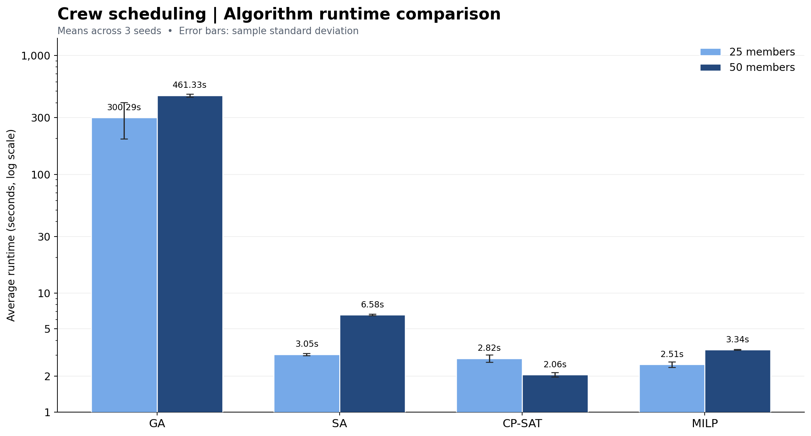
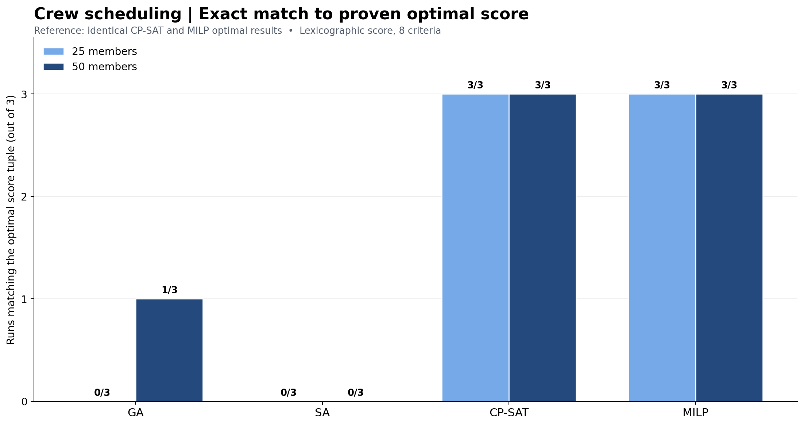

# Benchmark results — Crew Scheduling Optimization

## Experimental setup

- Synthetic datasets: 25 and 50 crew members, fixed dataset seed 42 per size.
- 31 scheduling days; 5 crew members per day.
- Solvers: Genetic Algorithm (GA), Simulated Annealing (SA), CP-SAT, MILP.
- Random seeds: 42, 123, 2026, with the same data within each population size.
- 24 completed runs; all passed schedule validity checks.

## Runtime (seconds)

| Members | Algorithm | Mean ± sample SD | Min | Max | Matches optimal score |
|---:|:---|---:|---:|---:|---:|
| 25 | GA | 300.29 ± 101.02 | 190.25 | 388.83 | 0/3 |
| 25 | SA | 3.05 ± 0.07 | 3.00 | 3.13 | 0/3 |
| 25 | CP-SAT | 2.82 ± 0.19 | 2.64 | 3.03 | 3/3 |
| 25 | MILP | 2.51 ± 0.13 | 2.38 | 2.65 | 3/3 |
| 50 | GA | 461.33 ± 13.16 | 446.88 | 472.63 | 1/3 |
| 50 | SA | 6.58 ± 0.09 | 6.48 | 6.65 | 0/3 |
| 50 | CP-SAT | 2.06 ± 0.09 | 1.95 | 2.12 | 3/3 |
| 50 | MILP | 3.34 ± 0.02 | 3.33 | 3.36 | 3/3 |

## Optimal score tuples (lexicographic, lower is better)

- **25 members:** `(0, 35, 7049, 15, 160, 85, 5, 51)`
- **50 members:** `(0, 0, 0, 40, 919, 144, 30, 618)`

Both CP-SAT and MILP returned these same score tuples in all six size/seed combinations, with optimal statuses at all seven solving stages.
GA reached the same tuple once (50 members, seed 2026); SA did not match it in any run.

## Figures

## Interpretation and limitations

- Report score vectors lexicographically; do **not** add or average their components into a single scalar.
- Matching the score of an optimal solver does not mean GA independently proved optimality.
- Three seeds per configuration provide a descriptive comparison, not a robust estimate of statistical significance.
- All timing comparisons depend on the test hardware, implementation, and solver settings; report these alongside results when known.
- Parallel exact solvers can exhibit non-deterministic timing and search paths despite fixed seeds.

Source data: `benchmark_results.csv`. All results here were computed from the recorded runs.
